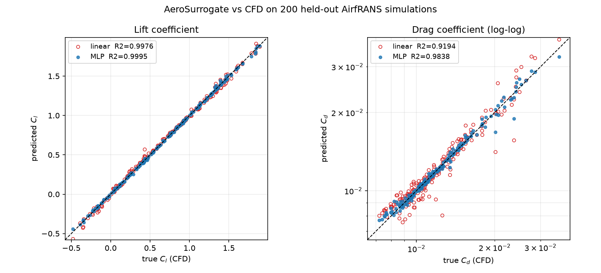
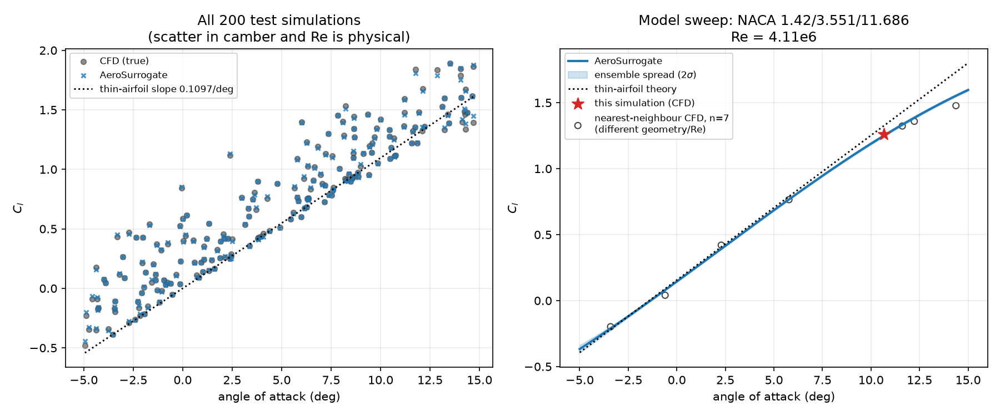
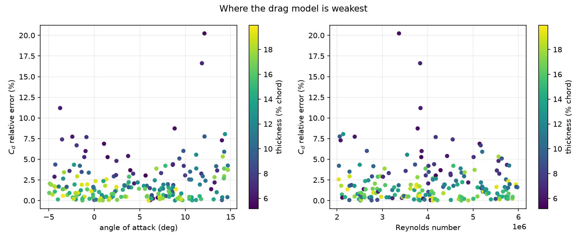

# AeroSurrogate

**Ask "how much lift and drag will this wing shape make?" and get the answer in under half a millisecond, instead of waiting ~25 minutes for a supercomputer-style simulation.**

> No physics background needed. Every term is explained in plain language with an everyday example the first time it appears. A glossary is at the end.

---

## Table of contents

1. [The 60-second version](#1-the-60-second-version)
2. [Physics from zero: what you need to know](#2-physics-from-zero-what-you-need-to-know)
3. [The problem we are solving](#3-the-problem-we-are-solving)
4. [Results (with what the numbers mean)](#4-results-with-what-the-numbers-mean)
5. [Try it in 3 minutes (no dataset needed)](#5-try-it-in-3-minutes-no-dataset-needed)
6. [Using the demo page](#6-using-the-demo-page)
7. [Using the API](#7-using-the-api)
8. [Rebuild everything from scratch](#8-rebuild-everything-from-scratch)
9. [How it works, step by step](#9-how-it-works-step-by-step)
10. [What we found along the way (the detective story)](#10-what-we-found-along-the-way-the-detective-story)
11. [Where the model fails (honestly)](#11-where-the-model-fails-honestly)
12. [Project map](#12-project-map)
13. [Troubleshooting](#13-troubleshooting)
14. [FAQ](#14-faq)
15. [Glossary](#15-glossary)
16. [Credits and provenance](#16-credits-and-provenance)

---

## 1. The 60-second version

- An **airfoil** is the cross-section shape of a wing. Its shape, the angle it meets the wind, and the air speed decide how much it **lifts** (goes up) and how much it **drags** (gets slowed down).
- Engineers normally find those two numbers by running a **CFD simulation**: a computer chops the air around the wing into hundreds of thousands of tiny cells and solves physics equations on each. One run takes about **25 minutes on 16 CPU cores**.
- We trained a small **neural network** (a "surrogate", meaning a fast stand-in) on 200 finished simulations. Now it predicts lift and drag for a *new* wing in **~0.4 milliseconds**.
- On 200 simulations it had **never seen**, its lift is off by about **2.3%** on average and its drag by about **2.2%**. A plain straight-line formula (the "linear baseline") is off by about **5%** on both.
- There is a **web page with a slider**: drag the angle of the wing, watch lift and drag update instantly, and compare against the real simulation answer.

```
Input:   wing shape (e.g. NACA 2412), angle (4°), air speed-ish number (Reynolds 3 million)
Output:  lift = 0.642    drag = 0.00983    (in 0.4 milliseconds)
```

---

## 2. Physics from zero: what you need to know

Skip this if you know aerodynamics. Otherwise, read it once; everything else builds on it.

### 2.1 What is an airfoil?

Slice a plane's wing straight across and look at the cut face. That teardrop-like outline is an **airfoil**. Birds, plane wings, helicopter blades, wind-turbine blades and even Formula 1 wings all use airfoils.

```
        ______----------_____
   ____/                     ‾‾‾‾‾‾----___          ← wind comes from the left
  (_____                                  ___>
        ‾‾‾‾-------________-------‾‾‾‾‾‾‾
  leading edge (front)              trailing edge (back)
```

- **Chord**: the straight-line distance from the front (leading edge) to the back (trailing edge). In this dataset the chord is always 1 metre, so everything is "per chord".
- **Thickness**: how fat the airfoil is, as a percentage of the chord. 12% thickness on a 1 m chord means 12 cm at its thickest.
- **Camber**: how much the airfoil is *curved* (bowed) compared with a flat line down its middle. A flat plate has zero camber. A symmetric airfoil (same top and bottom) has zero camber. A cambered airfoil is curved like a banana, a little. Example: bend a ruler slightly and hold it into the wind.

### 2.2 Lift and drag

Hold your hand flat out of a moving car window.

- Tilt it slightly upward: it gets **pushed up**. That is **lift**.
- Whatever way it is tilted, it also gets **pushed backward**. That is **drag**.

A plane wants lots of lift (to stay up) and little drag (to save fuel). The ratio of the two, **lift ÷ drag** (called **L/D**), is the classic measure of how efficient a wing is. A glider has a very high L/D, a brick has almost none.

### 2.3 Coefficients: why Cl and Cd instead of "newtons"

The actual force depends on wing size and air speed. A big wing in fast air makes huge forces; a small wing in slow air makes tiny ones. To compare shapes fairly, engineers divide the force by a reference amount of "wind pressure times area". The result is a pure number with no units:

- **Cl** ("coefficient of lift"): e.g. 0.64
- **Cd** ("coefficient of drag"): e.g. 0.0098

Think of it as a *score* for the shape, not a force. Multiply by the wing area and the wind pressure and you recover real newtons.

Typical values in this project:

| | Typical range | Meaning |
|---|---|---|
| Cl | −0.49 to +1.89 | negative = pushed down, ~0 = no lift, ~1+ = strong lift |
| Cd | 0.007 to 0.046 | small numbers; 0.01 is a clean low-drag wing |

Notice drag coefficients are about **100× smaller** than lift. That is normal.

### 2.4 Angle of attack (AoA)

The **angle of attack** is the angle between the wing's chord line and the oncoming wind. Tilt your hand up 5° into the wind: AoA = 5°.

```
  wind →   ────────────→
                      ╱ ← the wing's chord line, tilted up by AoA
```

Rule of thumb (from a famous result called *thin-airfoil theory*): **each extra degree of angle adds about 0.11 to Cl**. So going from 0° to 5° adds ~0.55 of lift coefficient. Our model learned this on its own (see [section 4](#4-results-with-what-the-numbers-mean)).

Push the angle too high and the airflow can no longer follow the top of the wing; it separates and lift collapses. That is a **stall**. Our data goes up to about 15°, mostly before stall.

### 2.5 Reynolds number

The **Reynolds number (Re)** is a single number that says how "fast and smooth versus sticky and swirly" the flow is. Formula: `Re = speed × length ÷ viscosity` (viscosity is how syrupy the fluid is).

Example: stirring honey (high viscosity, low Re) is slow and smooth. Stirring water fast (low viscosity, high Re) makes chaotic swirls. Real aircraft wings live at high Re: our data covers **2 million to 6 million**, which is like a small plane at moderate speed.

You do not need to feel it. You only need to know: it is one of the three dials we turn, and changing it changes drag noticeably (higher Re means thinner, less draggy boundary layers).

### 2.6 The NACA airfoil names

NACA (the predecessor of NASA) published a catalogue of airfoil shapes named by digits. This dataset uses two families:

**4-digit, e.g. NACA 2412**
- `2`: maximum camber is 2% of the chord
- `4`: the maximum camber sits 40% of the way back from the front
- `12`: the thickness is 12% of the chord

**5-digit, e.g. NACA 23012**
- first digit and the next two encode the camber design (this works differently from the 4-digit family)
- last two digits: thickness (12%)

Important catch: **a "2" in a 4-digit name and a "2" in a 5-digit name mean different things.** That matters for the AI, as explained in [section 9.3](#93-step-2-describe-every-shape-with-the-same-nine-numbers).

In this dataset the digits are not even whole numbers (for example `3.551_3.1_1.0_18.252`), so shapes are a continuous family, not just the catalogue's textbook ones.

### 2.7 What is CFD, and what is RANS?

**CFD** (Computational Fluid Dynamics) is simulating air flow on a computer. The computer splits the space around the wing into a **mesh** of small cells (this dataset's meshes have ~180,000 points each), and repeatedly solves the equations of fluid motion on every cell until the answer stops changing.

**RANS** is a particular, widely used way to handle turbulence (chaotic swirling) by averaging it out instead of simulating every swirl. It is a good compromise between speed and accuracy. "Steady 2D incompressible RANS" means: flat 2D slice of wing, air doesn't get squashed, nothing changes over time.

### 2.8 What is a "surrogate model"?

A **surrogate** is a cheap imitation of an expensive process.

Analogy: a chef takes 25 minutes to cook a dish from scratch (the CFD). You watch 200 finished dishes and learn to *predict the taste of a new recipe on paper*, in a blink. You will not be perfect, but for recipes similar to ones you have seen, you will be close. That is what our neural network does for wings.

---

## 3. The problem we are solving

Designing a wing means trying many shapes and angles. With CFD, trying 1,000 variations costs 1,000 × 25 minutes ≈ **17 days of 16-core compute**. With the surrogate it is **less than a second**.

What the surrogate takes in:

| Input | Example | Meaning |
|---|---|---|
| Airfoil shape | `[2, 4, 12]` (NACA 2412) | the wing cross-section |
| Angle of attack | `4.0` | degrees |
| Reynolds number | `3,000,000` | flow regime |

What it gives out:

| Output | Example | Meaning |
|---|---|---|
| `cl` | `0.642` | lift coefficient |
| `cd` | `0.00983` | drag coefficient |
| `cl_std`, `cd_std` | `0.0015`, `0.00002` | "how much do my 5 internal models disagree?" (a rough confidence) |
| `extrapolation` | `in_range: true` | "am I guessing outside what I was trained on?" |
| `inference_ms` | `0.43` | how long the prediction took |

---

## 4. Results (with what the numbers mean)

Everything below was measured on **200 simulations the model never saw during training** (the "test set"). This is the honest check: like grading an exam with questions the student hasn't memorised.

### 4.1 The scoreboard

| Predictor | Lift error (avg) | Drag error (avg) |
|---|---:|---:|
| Always guess the average | 148% | 25% |
| **Straight-line formula** ("linear baseline") | 5.2% | 5.9% |
| **Our neural network** | **2.3%** | **2.2%** |

How to read "error 2.3%": if the true lift coefficient is 1.00, our prediction is typically within 0.02 of it.

The full table with more metrics:

| Model | Cl MAE | Cl R² | Cd MAE | Cd R² |
|---|---:|---:|---:|---:|
| Mean predictor | 0.4975 | −0.0001 | 0.003352 | −0.0106 |
| Linear baseline | 0.0205 | 0.9976 | 0.000793 | 0.9194 |
| **Neural network** | **0.0090** | **0.9995** | **0.000303** | **0.9838** |

- **MAE** (mean absolute error): the average size of the miss, in the same units as the quantity. Lower is better.
- **R²**: "what fraction of the up-and-down variation did you explain?" 1.00 is perfect, 0 is no better than guessing the average. Ours: 0.9995 for lift, 0.984 for drag.

### 4.2 "Is the improvement real, or just luck?"

With only 200 test cases, one model could look better by chance. So we ran a **bootstrap**: re-draw 200 test cases at random (with repeats) 10,000 times and see how often the neural network beats the linear baseline.

- Lift: the network wins in **100%** of the 10,000 re-draws.
- Drag: the network wins in **100%** of the 10,000 re-draws.

Analogy: if one student beats another in 10,000 re-takes of the exam with shuffled questions, it is not a fluke.

### 4.3 "Did it learn real physics or just memorise numbers?"

A famous physics result says lift grows by ~**0.1097 per degree** of angle. We turned the wing in small steps and measured what *our model* says: **0.1073 per degree**. That is within 2.2%, and **we never told the model this rule**. It discovered it from data.

### 4.4 Speed

| Task | Time |
|---|---:|
| One CFD simulation (16 CPU cores) | ~25 minutes |
| One neural-network prediction (1 CPU core) | **0.39 milliseconds** |
| Same, including the web request overhead | ~2.7 ms |

That is roughly **3.8 million times faster** by the clock. Fair warning: the simulation produces the *entire flow field* (the air velocity and pressure everywhere), while the surrogate produces just two numbers. It is a fast answer to a narrower question.

### 4.5 Pictures

Predicted vs. true values (each dot is one test simulation; dots on the diagonal are perfect):



Lift against angle. Left: all 200 test simulations (grey = real, blue × = our prediction). Right: a smooth sweep for one wing, with the shaded band showing the 5 internal models' disagreement:



Where the drag prediction is weakest:



Ten worked examples spread across the angle range are in [`results/examples.md`](results/examples.md).

---

## 5. Try it in 3 minutes (no dataset needed)

The trained model (688 KB) and the answer key for the 200 test simulations are already in this folder. You do **not** need to download the 9 GB dataset to use the demo.

### Step 0: What you need

- A computer (Windows, macOS or Linux)
- **Python 3.12** installed ([python.org](https://www.python.org/downloads/)). Check with `python --version`.
- About 1 GB of free disk space for the Python packages (PyTorch is the big one)

### Step 1: Open a terminal in this folder

- **Windows**: open the folder in File Explorer, click the address bar, type `powershell`, press Enter.
- **macOS/Linux**: open Terminal and `cd` into the folder.

### Step 2: Create a private Python environment

An "environment" is a separate box of Python packages so this project does not mess up anything else on your computer.

```bash
python -m venv .venv
```

Activate it:

```powershell
# Windows PowerShell
.\.venv\Scripts\Activate.ps1
```
```bash
# macOS / Linux
source .venv/bin/activate
```

You should now see `(.venv)` at the start of your prompt.

> If PowerShell refuses with "running scripts is disabled", run `Set-ExecutionPolicy -Scope CurrentUser RemoteSigned` once, then try again. Or skip activating and call `.\.venv\Scripts\python.exe` directly in every command below.

### Step 3: Install the five packages the demo needs

```bash
pip install -r requirements-serve.txt
```

### Step 4: Start the server

```bash
uvicorn api:app --port 8000
```

Leave this terminal window open. You should see something like `Uvicorn running on http://127.0.0.1:8000`.

### Step 5: Open the demo

Go to **<http://127.0.0.1:8000>** in your web browser. Done.

To stop the server later, click the terminal and press `Ctrl + C`.

---

## 6. Using the demo page

### 6.1 The layout

```
┌────────────────┬─────────────────────────────────────────┐
│ AIRFOIL        │  Lift Cl   Drag Cd   L/D   Inference     │
│  4-digit/5-dig │  0.642     0.00983   65.3  0.98 ms       │
│  sliders for   │  [ within the training envelope ]        │
│  shape         ├─────────────────────────────────────────┤
│ FLOW           │  SECTION: the drawn wing outline         │
│  angle slider  ├─────────────────────────────────────────┤
│  Reynolds      │  LIFT CURVE: lift vs angle, with band    │
│ COMPARE WITH   │                                          │
│  CFD dropdown  │                                          │
└────────────────┴─────────────────────────────────────────┘
```

### 6.2 Things to try (a guided tour)

**Tour 1: See lift grow with angle.**
Drag **Angle of attack** from 0° to 10°. Watch **Lift** climb steadily. The wing outline stays the same; only the wind angle changes.

**Tour 2: Change the shape.**
Increase **M (max camber)** from 2 to 6. The drawn wing visibly bows more, and lift at the same angle goes **up**. Cambered wings lift even at 0°. Set camber to 0 and a flat-bottomed-symmetric shape gives zero lift at 0°.

**Tour 3: Make it thicker.**
Slide **XX (thickness)** from 12 to 25. Notice **drag** rises. Fat wings push more air out of the way.

**Tour 4: Compare with the real simulation (the best one).**
Open the dropdown **"Load a held-out test simulation…"** and pick any row. Every control snaps to the exact wing, angle and Reynolds number of a real CFD run. A grey box appears showing:

```
CFD ground truth — airFoil2D_SST_35.49_10.54_0.884_6.154_1.0_10.173
Cl 1.1847 vs 1.1730 predicted (-0.0117)
Cd 0.01546 vs 0.01597 predicted (3.32%)
```

That is the *real* answer from the 25-minute simulation next to our 0.4 ms guess. Now **drag the angle slider away**: the ground-truth box disappears (we no longer have a real simulation for that new angle) and the red × marker on the curve stays behind where the real point was. The blue curve keeps predicting.

**Tour 5: Go too far on purpose.**
Push the angle to 18° or the Reynolds number to 7. The badge changes to an orange **"extrapolating"** warning and the out-of-range part of the plot is shaded. The model is guessing beyond what it saw. See [section 11](#11-where-the-model-fails-honestly).

### 6.3 What the shaded band means

The blue band is "±2 standard deviations across the 5 internal models". It is narrow where the 5 models agree (usually where there is training data) and widens where they disagree. It is a *rough* confidence cue, not a guarantee.

---

## 7. Using the API

An **API** is a way for programs (not people) to talk to our model. The server you started in Step 4 also answers these web addresses.

### 7.1 Predict one case

**Windows PowerShell**
```powershell
curl.exe -X POST http://127.0.0.1:8000/predict -H "Content-Type: application/json" -d '{\"naca\":[2.0,4.0,12.0],\"aoa_deg\":4.0,\"reynolds\":3.0e6}'
```

**macOS / Linux**
```bash
curl -X POST http://127.0.0.1:8000/predict \
  -H "Content-Type: application/json" \
  -d '{"naca":[2.0,4.0,12.0],"aoa_deg":4.0,"reynolds":3.0e6}'
```

**Python**
```python
import requests
r = requests.post("http://127.0.0.1:8000/predict",
                  json={"naca": [2.0, 4.0, 12.0], "aoa_deg": 4.0, "reynolds": 3.0e6})
print(r.json())
```

Reply (shortened):
```json
{
  "cl": 0.6417, "cd": 0.00983, "inference_ms": 0.43,
  "cl_std": 0.00145, "cd_std": 0.00002,
  "extrapolation": {"in_range": true, "warnings": []},
  "reference": null
}
```

### 7.2 What goes in `naca`

| You want | Send | Example |
|---|---|---|
| 4-digit airfoil | 3 numbers `[M, P, XX]` | NACA 2412 → `[2, 4, 12]` |
| 5-digit airfoil | 4 numbers `[L, P, Q, XX]` | NACA 23012 → `[2, 3, 0, 12]` |

`XX` is thickness in percent. For 5-digit, `Q` must be `0` or `1`.

### 7.3 All the endpoints

| Address | What it does |
|---|---|
| `POST /predict` | lift and drag for one case |
| `POST /sweep` | lift and drag for many angles at once (the demo's lift curve) |
| `GET /geometry?naca_params=2,4,12` | the wing's outline as x/y points |
| `GET /meta` | model details and the training ranges |
| `GET /health` | "is the server alive?" |
| `GET /test-cases` | the 200 real simulations (the answer key) |
| `GET /docs` | automatic interactive documentation page: click, try, see results |

### 7.4 What happens with bad input

| You send | You get |
|---|---|
| `"naca": [1,2,3,4,5]` (wrong count) | **422** error: impossible |
| thickness 0 | **422** error: impossible shape |
| Reynolds number ≤ 0 | **422** error |
| angle of 400° | **422** error |
| angle of 45° | **200 OK** + `"in_range": false` + warning |

Rule: *physically impossible* input is rejected; *merely unusual* input is answered with a warning, so you can see where the model stops being trustworthy.

---

## 8. Rebuild everything from scratch

This re-creates the data, the model and every result. **You do not need this to use the demo.** Do it if you want to verify our claims or change something.

### 8.1 Requirements

- Python 3.12
- ~1 GB disk for packages + under 200 MB of working space for the data (it is *streamed*; see below)
- Internet access; the data pipeline downloads about **4 GB** in total
- About **30 minutes** for the data step; a few minutes for everything else

### 8.2 Install everything

```bash
python -m venv .venv
# activate it (see Step 2 above)
pip install -r requirements.txt
```

`requirements.txt` pins exact versions that were verified to work. The AirfRANS helper library is old (2023) and reads 3D mesh files using a package called VTK, so using the pinned versions matters.

### 8.3 The six commands

```bash
python data.py peek             # 1. look at the remote data (3 MB, no meshes yet)
python data.py build            # 2. stream 400 simulations (~25 min, ~4 GB over the network)
python data.py check            # 3. run 20 sanity checks on the result
python train.py --loss huber    # 4. train the model
python evaluate.py              # 5. measure it, make the plots and tables
pytest -q                       # 6. run the 55 tests
```

What each does, in plain words:

**1. `data.py peek`** peeks at the 9.3 GB dataset *without downloading it*. It confirms the server works, the file has the expected size, and that it contains the 1,000 simulations. Takes seconds.

**2. `data.py build`** is the long one. For each of 400 simulations it fetches only the two files it needs, computes the lift and drag, then **immediately deletes the files**. If it stops (Wi-Fi drops, laptop sleeps), just run it again: it resumes where it stopped. It prints a progress line like `45/390  18.4/min  eta 18.8 min`.

**3. `data.py check`** runs 20 checks and prints PASS/FAIL for each (no duplicate names, values in physically sensible ranges, drag = pressure part + friction part, and so on). Output also saved in `results/data_checks.txt`.

**4. `train.py --loss huber`** trains the network. **Important:** always include `--loss huber`; the plain default (`mse`) gives worse results (see [section 10, finding 3](#10-what-we-found-along-the-way-the-detective-story)).

**5. `evaluate.py`** scores the model on the 200 unseen simulations and writes everything into `results/` (numbers, plots, tables).

**6. `pytest -q`** should print `55 passed`.

### 8.4 Why not just download the dataset?

The dataset is **9.34 GB zipped / 14 GB unzipped**. We had a **1 GB disk budget**. So we built a trick (explained in [section 9.2](#92-step-1-getting-the-data-without-downloading-it)): read just the few megabytes we need from the remote file, one simulation at a time.

### 8.5 Reproducibility

Running `train.py` and `evaluate.py` again gives **identical** numbers (to the last digit) for every accuracy metric. Only the speed measurements wiggle, because computers are never exactly equally fast twice.

---

## 9. How it works, step by step

```
 ┌────────────────────┐   HTTP range    ┌────────────┐   9 numbers   ┌──────────┐
 │ 9 GB dataset online│ ──────────────▶ │  data.py   │ ────────────▶ │ train.py │
 │ (1,000 simulations)│  a few MB each  │ Cl, Cd per │  per wing     │ network  │
 └────────────────────┘                 │ simulation │               └────┬─────┘
                                        └────────────┘                    │ model.pt
                                                                          ▼
                           ┌────────────┐   ┌─────────────┐   ┌────────────────────┐
                           │ web page   │◀──│   api.py    │◀──│ artifacts/model.pt │
                           │ (sliders)  │   │ (FastAPI)   │   └────────────────────┘
                           └────────────┘   └─────────────┘
                                                  ▲
                                          evaluate.py checks everything
```

### 9.1 Step 0: Where the training data comes from

**AirfRANS** is a public dataset of 1,000 real CFD simulations of airfoils (published at NeurIPS 2022). Each simulation has the wing's shape, the angle and wind speed, and the full computed flow around it.

We did not use all 1,000. Our 1 GB limit meant we could afford about 400, so we used the dataset's official **"scarce" task**: 200 simulations to train on and 200 to test on. (The authors designed this task precisely to study learning from little data.)

### 9.2 Step 1: Getting the data without downloading it

A `.zip` file has a table of contents at its very end, listing where each file sits inside. The server hosting the dataset lets you ask for *just a byte range* ("give me bytes 5,000,000 to 6,000,000").

So `remote_zip.py` pretends the remote file is a local one:

1. Read the table of contents (~2 MB).
2. For each simulation, ask the server for only its two needed files (~15 MB).
3. Compute the answer, then delete the files.

Analogy: instead of buying a whole 1,000-page encyclopedia, you photocopy exactly the 2 pages you need, read them, and throw the copies away.

Safety features: automatic retries when the network hiccups; refusal to continue if the server does *not* support partial downloads (it would try to pull all 9 GB); a file-size check so we notice if the dataset changed.

Result: peak disk use about **90 MB**.

### 9.3 Step 2: Turning raw simulations into "answers"

The dataset gives the *air pressure and friction on the wing's surface*, not Cl and Cd directly. We add up the forces:

- **Pressure force**: air pressing on the surface (like water pressure on a diving board).
- **Friction force**: air rubbing along the surface (like a hand sliding along a table).
- Then split the total push into "straight up from the wind" (**lift**) and "straight back along the wind" (**drag**), and divide by the reference wind pressure to get the unit-free Cl and Cd.

The library function that does this is `force_coefficient()`. We tested our whole pipeline by recomputing a published example from the dataset's documentation: they say Cd=0.0134, Cl=0.8099; we get **0.013431** and **0.809893**. A match to four digits proved the downloader, the file reading, and the maths were all correct.

Fun facts we measured: friction accounts for **62% of drag** (so drag really does need the detailed flow), but only **0.05% of lift** (lift is almost entirely pressure).

### 9.3 (continued) Describing every shape with the same nine numbers

A neural network wants a fixed list of numbers per example. But NACA names are awkward: 4-digit has 3 numbers and 5-digit has 4, and *the same position means different things*. If we just fed the raw digits in, the network would mix up "2% camber" with a "design code 2".

So we describe each wing by what it **physically is**, which is the same for every wing:

| # | Number | Plain meaning | Everyday analogy |
|---|---|---|---|
| 1 | `max_camber` | how curved is it | how bowed a bent ruler is |
| 2 | `x_max_camber` | where is the curviest point | near the front or the back |
| 3 | `max_thickness` | how fat | thickness of a surfboard |
| 4 | `alpha_L0_deg` | the angle at which this wing makes *zero* lift | a curved wing still lifts at 0°, so you must tilt it *down* a bit to cancel it |
| 5 | `te_camber_slope` | how the curve tilts near the back edge | the tail's upturn |
| 6 | `is_5digit` | which family | label |
| 7 | `aoa_deg` | the wind angle | tilt of your hand |
| 8 | `aoa_eff_sq` | (angle − zero-lift angle)² | drag grows roughly like the *square* of the effective tilt |
| 9 | `log10_reynolds` | flow regime (log scale) | big range squeezed into a small one |

Number 4 is the star. Physics says lift ≈ 0.11 × (angle − zero-lift-angle), so *one number* summarises how much the curved shape helps.

**What the model predicts:** Cl directly, but **log(Cd)** for drag. Why? Drag is always positive and spans a factor of 6 (0.007 to 0.046); using the logarithm makes "being off by 10%" count the same whether the drag is small or large, and the prediction can never come out negative.

### 9.4 Step 3: The two competing predictors

**The linear baseline ("the straight-line formula").** Takes the 9 numbers, multiplies each by a learned weight, adds them up. Like a recipe: "Cl = 0.11·angle + 3·camber − ...". Simple, fast, easy to understand. This is the opponent we have to beat; if a fancy network cannot beat it, it is not worth the complexity.

**The neural network (MLP).** Same 9 inputs → 3 layers of 128 "neurons" → 2 outputs (Cl and log Cd). A neuron is just "weighted sum, then a small bend (the SiLU function)". The bends let the network capture curves and interactions a straight line cannot (for example, drag rising faster at high angles on thick wings). It has 34,562 adjustable weights.

Analogy: the linear model draws one straight ruler line through the data; the network can draw a flexible wire that bends to follow curved patterns.

**The ensemble.** We train the network **5 times** with different random starting points and average the answers. When the 5 disagree, we know the model is unsure; that disagreement is the shaded band in the demo.

### 9.5 Step 4: How the network learns

Learning loop (repeated 318 times, called *epochs*):

1. Show the network all 200 training wings.
2. Compare its guesses with the truth; measure the total miss (the **loss**).
3. Nudge every weight slightly in the direction that reduces the miss (this uses a method called **Adam**).

Three design decisions that mattered:

- **How long to train?** Train too little and it is clueless; too long and it *memorises* the 200 wings, then fails on new ones (**overfitting**; like a student who memorises last year's exam answers). We found the best stopping point by **5-fold cross-validation**: split the 200 into 5 groups, train on 4, test on the 1 left out, rotate. The sweet spot averaged over all that: **318 epochs**.
- **What counts as "a miss"?** We use the **Huber loss**: small misses count as squares (like normal), huge misses count only linearly. This stopped one very strange wing from dominating the training (see finding 3 below).
- **Fairness.** The numbers are rescaled using only the training wings' averages, and the 200 test wings are **never touched** until the final exam.

### 9.6 Step 5: Serving it fast

PyTorch (the training library) has a fixed overhead per call that is bigger than the maths for a net this small. So the server runs the forward pass in plain **numpy** (a maths library), stacking the 5 ensemble members into single matrix operations. That took one prediction from 1.7 ms down to about 0.4 ms. The server also remembers shapes it has already described (a cache), so sweeping 131 angles for one wing computes the geometry only once.

### 9.7 Step 6: One definition of the inputs (a subtle but crucial design)

The most dangerous bug in any ML project is **train/serve skew**: the training code computes the inputs slightly differently from the serving code. Nothing crashes; answers are just quietly wrong.

Defence: `features.py` is the **only** place the nine numbers are defined, and a test (`test_train_serve_parity`) checks that a wing from the training table and the same wing arriving through the web API produce **bit-for-bit identical** inputs.

---

## 10. What we found along the way (the detective story)

Building this was not a straight line. Four surprises changed the result; each is a real lesson about working with data.

### Finding 1: A wing family with an inconsistent shape description

In the open-source library we borrowed from, 4-digit wings whose "camber position" digit is exactly 0 (about **24% of the 4-digit wings**) were described *contradictorily*: "this wing has no curve at all" **and** "this wing has a tilted curve". The code would then compute a zero-lift angle of up to −6°, as if the wing were strongly curved.

How we figured out which was right: **ask the simulations.** Lift ≈ 0.11 × (angle − zero-lift-angle), so for each wing we can *back out* the zero-lift angle the simulation implies. For those 48 wings it was **+0.24° ± 0.46°**, essentially zero: they are *not* curved. Fix: compute the angle from the actual curve numerically. The match with simulation went from correlation **0.78 to 0.94**.

Lesson: when two parts of the data disagree, let physics-grounded ground truth be the judge.

### Finding 2: A dial that does nothing

5-digit wings have a digit `Q` (0 = normal, 1 = "reflex", an S-shaped tail). We proved mathematically that in this code `Q=0` and `Q=1` produce *identical* shapes, and that the real simulation meshes match that identical shape to 0.0004 chord lengths. The digit carries no information, so we leave it out of the model's inputs.

Lesson: more inputs is not better; useless inputs are noise.

### Finding 3: One strange wing was 99% of the training signal

One wing (5.2% thick, angle −4.4°) has the highest drag in the whole dataset, four standard deviations above typical. With the usual squared-error loss it contributed about **99% of the loss** on its group, so the network wasted effort contorting itself for one oddball.

Switching to the **Huber loss** (which caps the influence of extremes) cut the cross-validated error by **16%** and test lift error from 0.0109 to **0.0090**. After that fix, network *size* hardly mattered: anything from 466 to 34,562 weights performed within 4%.

Lesson: look at your errors, not just their average.

### Finding 4: 20 examples are too few to decide when to stop

The textbook method sets aside 10% (20 wings) to decide when to stop training. With only 20, three of our five networks stopped far too early, while still being badly wrong on the training data. It *looked* like success (the stopping rule fired) while the models were half-trained.

Fix: decide the stopping point by cross-validation on all 200 instead, and use *absolute* error (not squared) to judge, so oddballs do not rule. After that, the 5 networks agreed with each other closely.

Lesson: a check that always says "fine" is not a check.

---

## 11. Where the model fails (honestly)

A trustworthy project says where it breaks. Here is where:

### 11.1 Outside its training range ("extrapolation")

The model is an **interpolator**: good *between* wings it has seen, unreliable far outside them. We measured this directly: we retrained on only angles from −2.5° to 12.5°, then tested on angles outside that band.

| | Inside the trained angles | Outside them | Gets worse by |
|---|---:|---:|---:|
| Lift error | 0.0070 | 0.0208 | **3.0×** |
| Drag error | 0.00023 | 0.00058 | **2.5×** |

We also wrote down a **prediction before running** it: "lift will degrade mildly, drag badly" (since lift is nearly a straight line in angle). **We were wrong**: lift degraded *more*. The real lift curve bends over near stall, and a model that only saw the straight part keeps going straight. (We kept the wrong prediction in the record on purpose.)

The training range is: angle −4.8° to 14.8°, Reynolds 2.0 to 6.0 million, thickness 5% to 20%. The API flags anything outside it.

### 11.2 Other limits

1. **Flat 2D, steady, smooth-air physics only.** No 3D wing tips, no gusts, no ice.
2. **Only NACA 4- and 5-digit shapes.** Not arbitrary CAD wings, not supersonic shapes.
3. **Two numbers only.** It cannot tell you *where* the pressure acts, whether air has separated from the wing, or how near a stall you are, which is often what an engineer actually needs.
4. **Weak on thin wings at high angle.** The worst drag prediction (error 0.0048) was a 5.7%-thick wing at 12.1°. Few such cases exist in 200 training wings.
5. **Small test set.** 200 cases means each error figure has about ±7% wiggle. This is why we report the bootstrap.
6. **Only 200 training wings.** The "scarce" task. More data would likely help (we did not use the full 800 because of the 1 GB disk budget).

### 11.3 Do not compare these numbers with the AirfRANS paper

The AirfRANS paper's benchmark is predicting the **air pressure and speed at every one of ~180,000 mesh points**, a much harder problem. We predict **two numbers per wing** from nine inputs. Different task, different difficulty. Quoting the two side by side would be misleading in both directions.

---

## 12. Project map

```
AeroSurrogate/
├── README.md              ← you are here
├── PROJECT_SUMMARY.md     ← a shorter technical summary
├── config.py              constants: file paths, dataset URL, physics constants, seeds
├── naca.py                parse wing names; build wing geometry (pure maths, no heavy libs)
├── features.py            THE definition of the 9 inputs and the 2 outputs
├── remote_zip.py          reads part of a remote zip file (the "photocopy 2 pages" trick)
├── data.py                peek / build / check / refresh: makes data/coeffs.parquet
├── model.py               network shape + fast numpy prediction
├── train.py               teaches the network; saves artifacts/
├── evaluate.py            exam-marking: metrics, plots, tables, answer key for the demo
├── api.py                 the web server (FastAPI)
├── web/
│   ├── index.html         the slider demo page
│   └── test_reference.json  true answers for the 200 test simulations
├── artifacts/
│   ├── model.pt           the trained network (688 KB)
│   └── model_meta.json    what it was trained on, settings, training ranges
├── results/               metrics.json, scatter.png, lift_curve.png, residuals.png, tables
├── tests/                 55 automatic checks
├── data/                  (rebuilt by data.py; ~0.3 MB; not needed for the demo)
├── requirements.txt       everything needed to rebuild
└── requirements-serve.txt only what the demo needs (5 packages)
```

Plain-English map of "who calls whom":

- `data.py` uses `remote_zip.py` + `naca.py` to build the table.
- `train.py` uses `features.py` + `model.py` to teach the network.
- `evaluate.py` and `api.py` both use `features.py` + `model.py` (that is how train/serve parity is guaranteed).

---

## 13. Troubleshooting

| Problem | Likely cause | Fix |
|---|---|---|
| `python: command not found` | Python not installed or not on PATH | Install Python 3.12; on Windows try `py -3.12` |
| PowerShell: "running scripts is disabled" | Windows script policy | `Set-ExecutionPolicy -Scope CurrentUser RemoteSigned`, or call `.\.venv\Scripts\python.exe` directly |
| `pip install` is slow / huge | PyTorch is ~200 MB+ | normal; wait |
| `uvicorn: command not found` | environment not activated | activate it, or `python -m uvicorn api:app --port 8000` |
| Browser shows "can't connect" | server not running or other port | check the terminal still shows Uvicorn running; try another `--port 8001` |
| `Address already in use` | port 8000 taken | use `--port 8001` and open that address |
| Page loads but says "Could not reach the API" | you opened `web/index.html` as a file | start the server and use <http://127.0.0.1:8000> |
| `FileNotFoundError: artifacts/model.pt` | model not trained / folder missing | run `python train.py --loss huber` (needs `data/coeffs.parquet`) |
| `data.py build` connection timeout | the university server hiccuped | just run the same command again; it resumes |
| `data.py build` is slow | network-limited (~18 simulations/min) | normal: about 25 min total |
| Results differ slightly from README | forgot `--loss huber` | retrain with `python train.py --loss huber` |
| Tests skip some checks | `data/` or `results/` missing | run the data, train and evaluate steps first |
| `ModuleNotFoundError: airfrans` when training | installed only the serve requirements | `pip install -r requirements.txt` |

---

## 14. FAQ

**Do I need to know physics or machine learning to run this?**
No. Section 5 is copy-paste.

**Why 0.4 ms instead of "instant"? Is that slow?**
That *is* instant; it is 2,500 predictions per second on one CPU core. The demo's whole lift curve (131 points) costs milliseconds.

**Could I use this to design a real aircraft?**
No. It is a learning/demo project: 2D, 200 training examples, NACA shapes only. Real design needs validated tools and wind-tunnel or flight data.

**Why a neural network if a straight line is already within 5%?**
Because the improvement from 5% to 2% is real (100% of bootstrap re-draws agree), and drag in particular bends in ways a line cannot capture. It also taught us when the fancy model *is* worth it.

**Why is the demo not using React?**
The page is a single HTML file with plain JavaScript, so it has no build step and no internet dependency. It runs anywhere, even offline.

**What does "held-out" mean?**
Not used for training or for any decision during building. The model has never seen those 200 wings; it is a genuine exam.

**What is a "bootstrap"?**
Re-drawing the test set at random with repeats thousands of times to see whether a result survives reshuffling. If it wins every time, it is not luck.

**Can I add my own wing?**
Yes: send any 3 numbers (4-digit) or 4 numbers (5-digit) to `/predict`, or use the sliders. Stay within thickness 5–20%, angle −5 to 15°, Re 2–6 million for reliable answers; otherwise expect an "extrapolating" warning.

**Why does the 5-digit shape sometimes ignore my "reflex" setting?**
Because in this dataset's geometry it truly makes no difference (finding 2).

**Can I train on more data?**
Yes. In `config.py` change `TASK_SPLITS` to include more splits (for example `full_train`), run `data.py build` (≈ 10 MB per extra simulation over the network), then retrain. You will need more disk and time.

**Is the data free to use?**
AirfRANS is released under the Open Data Commons ODbL license. Check its terms before redistributing.

---

## 15. Glossary

| Term | Plain-English meaning |
|---|---|
| **Airfoil** | the cross-section outline of a wing |
| **Angle of attack (AoA)** | how much the wing is tilted into the wind, in degrees |
| **Boundary layer** | the thin skin of slowed-down air hugging a surface |
| **Bootstrap** | re-testing on randomly re-drawn copies of the test set to check a result is not luck |
| **Camber** | how curved (bowed) an airfoil is |
| **CFD** | simulating air flow on a computer |
| **Cd / Cl** | drag / lift "scores", unit-free numbers independent of wing size and wind strength |
| **Chord** | front-to-back length of the airfoil (1 m here) |
| **Cross-validation** | splitting data into groups and rotating which is held out, to judge fairly |
| **Drag** | the backward force from moving through air |
| **Ensemble** | several models whose answers are averaged; their disagreement is a confidence signal |
| **Epoch** | one full pass over the training data |
| **Extrapolation** | predicting outside the range of the training data |
| **Feature** | one input number to the model |
| **Held-out / test set** | data kept secret from training for the final exam |
| **Huber loss** | a way of measuring errors that does not let one huge miss dominate |
| **Interpolation** | predicting between known data points |
| **Lift** | the force perpendicular to the wind, the one that holds planes up |
| **L/D** | lift divided by drag: aerodynamic efficiency |
| **Linear baseline** | the simple weighted-sum predictor we must beat |
| **MAE** | mean absolute error: the average size of the miss |
| **Mesh** | the grid of tiny cells a simulation solves on |
| **MLP** | multi-layer perceptron: the basic neural network used here |
| **NACA** | the old US agency that catalogued airfoil shapes with digit codes |
| **Overfitting** | memorising the training examples instead of learning the pattern |
| **R²** | fraction of the variation explained (1 = perfect, 0 = guessing the mean) |
| **RANS** | a standard way to simulate turbulent flow by averaging the swirls |
| **Reynolds number (Re)** | one number describing how fast/smooth vs sticky/chaotic a flow is |
| **Stall** | when the air can no longer follow the wing and lift drops suddenly |
| **Surrogate** | a fast, approximate stand-in for a slow process |
| **Thin-airfoil theory** | classic result: lift grows ~0.11 per degree of angle |
| **Train/serve skew** | training and live code computing inputs differently, causing silent errors |
| **Zero-lift angle** | the angle at which a given wing makes no lift (negative for curved wings) |

---

## 16. Credits and provenance

- **Dataset**: AirfRANS — Bonnet, Mazari, Cinnella & Gallinari, *NeurIPS 2022 Datasets & Benchmarks*, [arXiv:2212.07564](https://arxiv.org/abs/2212.07564). License: [ODbL-1.0](https://opendatacommons.org/licenses/odbl/1-0/). Streamed from `data.isir.upmc.fr`.
- **CFD time reference** (~25 min on 16 cores): the same paper, Table 4.
- **Vendored code**: NACA geometry functions adapted from [`Extrality/airfrans_lib`](https://github.com/Extrality/airfrans_lib) (MIT license), with an iteration cap on one solver and a tolerance in place of an exact float comparison.
- **Environment used**: Python 3.12, PyTorch 2.14 (CPU), numpy 2.5, pyvista 0.49, VTK 9.7, airfrans 0.1.5.1, on Windows 11. Exact pins are in `requirements.txt`.
- **Where each number comes from**: everything quoted in this README is in `results/metrics.json`; the results and worked-example tables are generated by `evaluate.py`, so they cannot drift from the last run.
- **Task chosen**: the dataset's official `scarce` task (200 train, 200 test), because a 1 GB disk budget allowed streaming about 400 simulations.
